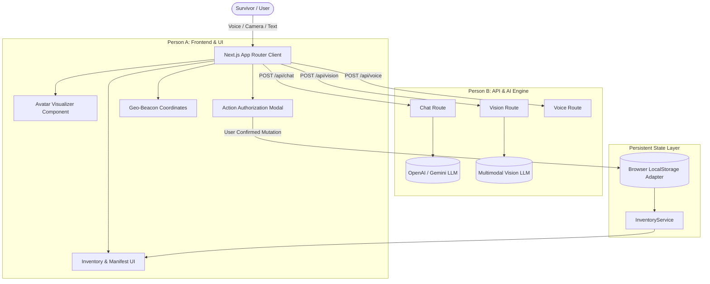

# ECHO — Architecture & System Design

## Architecture Overview

## Module Ownership & Boundary Isolation

| Domain | Responsible Developer | Key Files / Directories |
|---|---|---|
| **Frontend Visual Experience** | Person A | `app/page.tsx`, `app/layout.tsx`, `app/globals.css`, `components/avatar/`, `components/dashboard/`, `components/inventory/`, `components/maps/`, `components/ui/` |
| **Backend AI & State Services** | Person B | `app/api/**`, `lib/ai/**`, `lib/inventory/**`, `lib/memory/**`, `lib/storage/**`, `components/voice/`, `hooks/` |
| **Shared Contracts** | Person A & B (Joint) | `types/echo.ts` |
